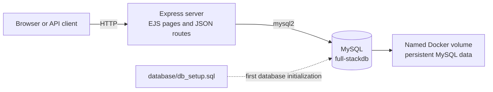

# Full-Stack Express Toolbox

A server-rendered Node.js application for exploring essential tools across six full-stack technology areas. Express serves EJS pages and JSON endpoints, while MySQL stores a normalized catalog of 32 tools and 48 area/tool memberships. Docker Compose provides the complete local environment.

## Project Architecture



The browser and API client use the same Express service. HTML handlers render EJS templates; JSON handlers return area and tool data. MySQL runs in a separate container and is reachable by the server through the Compose network.

## Project Structure

```text
simple_express_server-lab/
├── database/
│   ├── db_setup.sql          # Database schema and seed data
│   └── dockerfile            # MySQL image and initialization script
├── server/
│   ├── controllers/
│   │   └── index.js          # Queries, validation, pages, and JSON handlers
│   ├── public/
│   │   └── styles.css        # Responsive application styles
│   ├── routes/
│   │   └── index.js          # HTML and JSON route definitions
│   ├── views/
│   │   ├── partials/
│   │   │   ├── footer.ejs
│   │   │   └── head.ejs
│   │   ├── area.ejs          # Tools for one technology area
│   │   ├── error.ejs         # HTML error states
│   │   ├── index.ejs         # Technology-area explorer
│   │   └── tools.ejs         # Complete tool catalog
│   ├── app.js                # Express configuration and entry point
│   ├── config.db.js          # MySQL connection configuration
│   ├── dockerfile            # Node.js application image
│   ├── package.json
│   └── pnpm-lock.yaml
├── .env.dev                  # Local Compose configuration; create locally
├── docker-compose.yml        # MySQL and Express services
└── README.md
```

## Features

- **Six technology areas:** DevOps, Frontend, Backend, Mobile, CloudOps, and Quality Assurance.
- **Eight tools per area:** Each area table contains exactly eight tool references.
- **Normalized tool catalog:** Thirty-two canonical tool records support forty-eight memberships without duplicating tool definitions.
- **Transversal tool reuse:** Git, Docker, Kubernetes, Terraform, Prometheus, JavaScript, TypeScript, and Python are shared where applicable.
- **Server-rendered interface:** Responsive EJS pages provide an area explorer, individual area collections, and a complete catalog.
- **JSON endpoints:** Area and tool data can also be consumed by API clients.
- **Validated area queries:** Unknown areas return `404`; database failures return an error response instead of being thrown from route callbacks.
- **Containerized startup:** Compose starts MySQL before Express using a database health check.
- **Persistent database storage:** A named Docker volume retains MySQL data across ordinary container recreation.

## Database Design

The initialization script creates a database named **`full-stackdb`** with seven tables:

| Table | Purpose |
|---|---|
| `tools` | Stores each canonical `tool_id` and unique `tool_name` once. |
| `devops` | References the eight DevOps tools. |
| `frontend` | References the eight Frontend tools. |
| `backend` | References the eight Backend tools. |
| `mobile` | References the eight Mobile tools. |
| `cloudops` | References the eight CloudOps tools. |
| `quality_assurance` | References the eight Quality Assurance tools. |

Every area table uses `tool_id` as both its primary key and a foreign key to `tools.tool_id`. Reusing the same ID in multiple area tables represents transversal tools without copying their names or creating duplicate catalog records.

The schema and all seed records are defined in [`database/db_setup.sql`](database/db_setup.sql).

## Web Pages and JSON Endpoints

### HTML Pages

| Method | Path | Description |
|---|---|---|
| `GET` | `/` | Lists all six technology areas. |
| `GET` | `/areas/:area` | Displays the eight tools for one area. |
| `GET` | `/catalog` | Displays all 32 unique tools. |

Valid area slugs are `devops`, `frontend`, `backend`, `mobile`, `cloudops`, and `quality_assurance`. For example, `/areas/devops` displays the DevOps collection.

### JSON Endpoints

| Method | Path | Description |
|---|---|---|
| `GET` | `/areas` | Returns the six valid area slugs. |
| `GET` | `/areas/:area/tools` | Returns an area and its eight tools. |
| `GET` | `/tools` | Returns the complete canonical tool catalog. |

## Prerequisites

For the Docker Compose deployment, install:

1. [Docker Engine or Docker Desktop](https://docs.docker.com/get-docker/).
2. Docker Compose v2, included with current Docker Desktop and Docker Engine installations. Verify it with:
   ```sh
   docker compose version
   ```
3. Git to clone the repository.

Node.js and pnpm are not required on the host for the Compose workflow; application dependencies are installed inside the server image.

## Usage

### Local Deployment

1. **Clone the repository and enter its directory:**
   ```sh
   git clone https://github.com/RecursiveDeveloper/simple_express_server-lab.git
   cd simple_express_server-lab
   ```

2. **Create `.env.dev` in the repository root.** This file is intentionally not tracked, so each clone must define its own local configuration:
   ```dotenv
   DB_IMAGE_NAME=mysql_db_image
   DB_CONTAINER_NAME=mysql_db_container
   DB_USER=root
   DB_PASS=replace-with-a-local-password
   DB_NAME=full-stackdb
   DB_LOCAL_PORT=3306
   DB_VOLUME_NAME=mysql_data

   SERVER_IMAGE_NAME=express_server_image
   SERVER_CONTAINER_NAME=express_server_container
   SERVER_LOCAL_PORT=3000
   ```

   | Variable | Purpose |
   |---|---|
   | `DB_IMAGE_NAME` | Name assigned to the locally built MySQL image. |
   | `DB_CONTAINER_NAME` | MySQL container name. |
   | `DB_USER` | Database user used by Express. The current Compose setup uses `root`. |
   | `DB_PASS` | MySQL root password and the password used by Express. Use a local-only secret. |
   | `DB_NAME` | Application database; keep `full-stackdb` to match the initialization script. |
   | `DB_LOCAL_PORT` | Database port value supplied through Compose; keep `3306` for the current internal service. |
   | `DB_VOLUME_NAME` | Name of the persistent MySQL Docker volume. |
   | `SERVER_IMAGE_NAME` | Name assigned to the locally built Express image. |
   | `SERVER_CONTAINER_NAME` | Express container name. |
   | `SERVER_LOCAL_PORT` | Host port mapped to Express port `3000`. |

3. **Build and start both services from the repository root:**
   ```sh
   docker compose --env-file .env.dev up --build -d
   ```

4. **Check service status and application logs:**
   ```sh
   docker compose --env-file .env.dev ps
   docker compose --env-file .env.dev logs -f express_server
   ```

5. **Open the application:**
   - Web interface: [http://localhost:3000](http://localhost:3000)
   - Tool catalog: [http://localhost:3000/catalog](http://localhost:3000/catalog)

   If `SERVER_LOCAL_PORT` is changed, use that host port instead of `3000`.

6. **Verify the JSON endpoints:**
   ```sh
   curl http://localhost:3000/areas
   curl http://localhost:3000/areas/devops/tools
   curl http://localhost:3000/tools
   ```

### Connecting to MySQL

MySQL is not published to a host port by the current Compose file. Access it through the service container:

```sh
docker compose --env-file .env.dev exec mysql_db mysql --user=root --password --database=full-stackdb
```

Enter the value configured for `DB_PASS` when prompted. Express reaches the same database at `mysql_db:3306` over the Compose network.

### Stopping Services

Stop and remove the containers and network while preserving the database volume:

```sh
docker compose --env-file .env.dev down
```

## Recreating and Completely Resetting the Lab

Rebuild application images without deleting seeded data:

```sh
docker compose --env-file .env.dev up --build -d
```

MySQL executes files in `/docker-entrypoint-initdb.d` only when its data directory is empty. Consequently, changes to [`database/db_setup.sql`](database/db_setup.sql) are **not** applied to an existing database volume.

> **Warning:** The following reset permanently deletes this lab's MySQL volume and all data in it.

To recreate the database from the latest SQL script:

```sh
docker compose --env-file .env.dev down --volumes
docker compose --env-file .env.dev up --build -d
```

To remove the containers, network, database volume, and locally built service images without immediately recreating them:

```sh
docker compose --env-file .env.dev down --volumes --rmi all
```

## Application Components

| Component | Responsibility |
|---|---|
| [`server/app.js`](server/app.js) | Configures Express, EJS, request parsing, routes, static assets, and port `3000`. |
| [`server/config.db.js`](server/config.db.js) | Creates the MySQL connection from environment variables. |
| [`server/routes/index.js`](server/routes/index.js) | Separates HTML page routes from JSON endpoints. |
| [`server/controllers/index.js`](server/controllers/index.js) | Owns area metadata, area validation, database queries, rendering, and API responses. |
| [`server/views`](server/views) | Contains the EJS pages and shared header/footer partials. |
| [`server/public/styles.css`](server/public/styles.css) | Defines the responsive visual design. |
| [`database/db_setup.sql`](database/db_setup.sql) | Creates and seeds the normalized database. |
| [`docker-compose.yml`](docker-compose.yml) | Builds and connects the Express and MySQL services. |

## Requirements

### Container Runtimes

| Component | Version or image |
|---|---|
| Node.js | `22.23.5-alpine3.24` |
| MySQL | `mysql:9.7.4.1` |
| Docker Compose | v2 |

### Application Dependencies

Versions below come from [`server/package.json`](server/package.json) and [`server/pnpm-lock.yaml`](server/pnpm-lock.yaml).

| Dependency | Declared range | Locked version |
|---|---|---|
| Express | `^5.2.1` | `5.2.1` |
| EJS | `^3.1.8` | `3.1.10` |
| mysql2 | `^3.2.0` | `3.22.3` |
| body-parser | `^1.20.0` | `1.20.5` |
| dotenv | `^17.4.2` | `17.4.2` |

## Authors

- [@RecursiveDeveloper](https://github.com/RecursiveDeveloper)

## License

[MIT](https://choosealicense.com/licenses/mit/)
